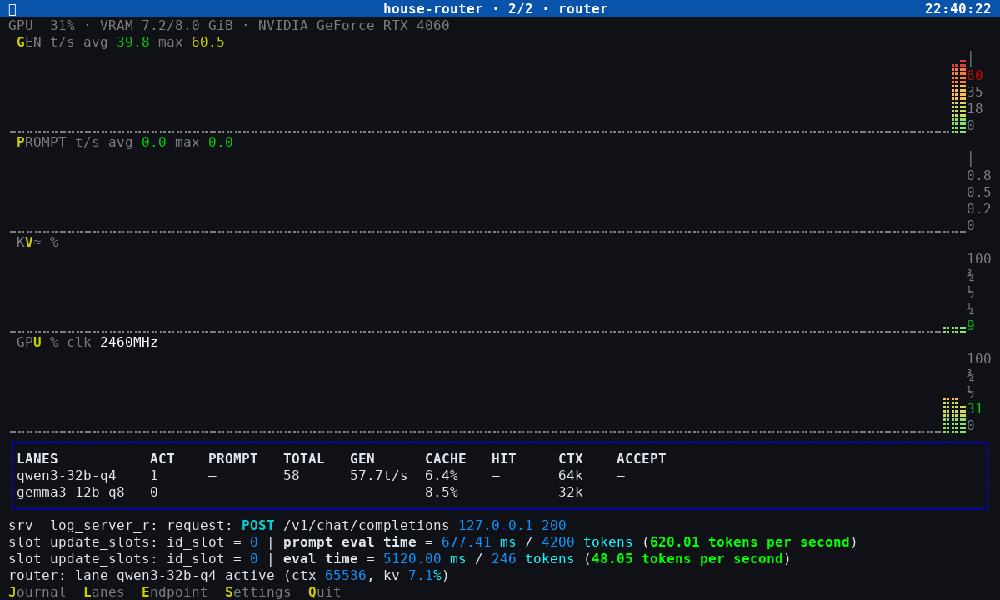
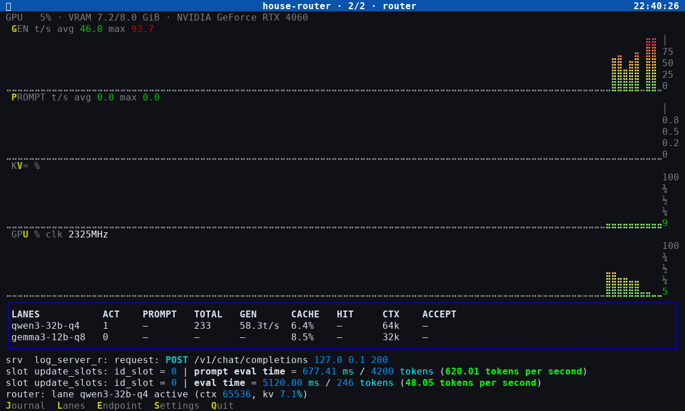
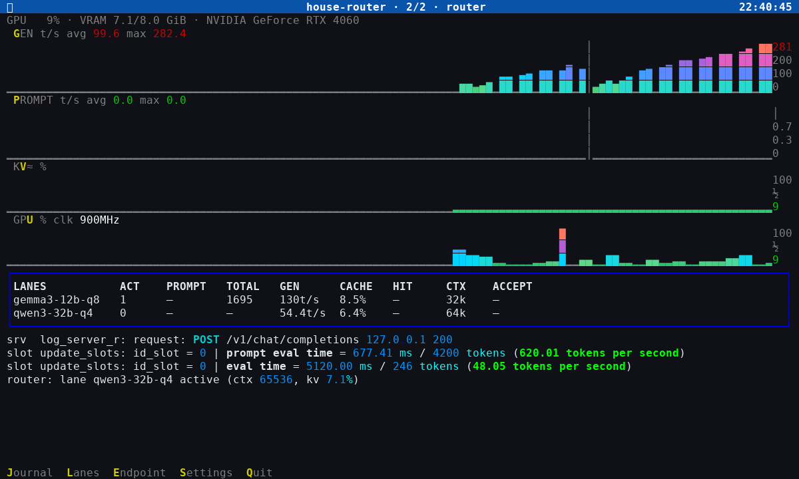
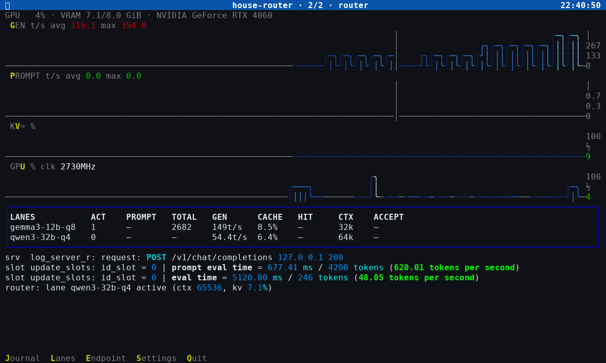
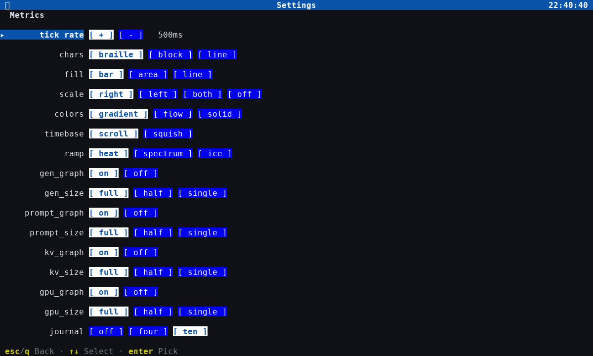

# lsmtop

> **Status:** Active development (WIP — pre-1.0). Layout, CLI flags, and config keys may evolve before `v1.0.0`.

A `top`-style terminal dashboard for [llama.cpp](https://github.com/ggml-org/llama.cpp)
servers and [llama-swap](https://github.com/Mostly-Mainly/llama-swap) routers:
live PROMPT / GEN throughput, KV occupancy, cache %, GPU/APU vitals,
per-model lanes, and the service journal — in one keyboard-first TUI.

lsmtop measures. Server lifecycle (start/stop/reload) and model downloads
are separate tools with separate UIs — one tool does one thing, well.

Built from scratch in Rust on plain ratatui. Rates come from the engine's
own counters and journal lines, graphs are unsmoothed, and busy-run numbers
match what the engine itself prints.



Alternate formats: [MP4](assets/demo.mp4) · [WebP](assets/demo.webp)

<details>
<summary>Static screenshots (Braille/Heat, Block/Spectrum, Line/Ice, Settings)</summary>

| Default (`braille` · `heat` · `gradient`) | Block (`block` · `spectrum`) |
|---|---|
|  |  |

| Line (`line` · `vert` · `flow` · `ice`) | Live Settings (`s`) |
|---|---|
|  |  |

</details>

## Quickstart

**Prebuilt binary** (static `x86_64` Linux — runs on any distro): download
`lsmtop-vX.Y.Z-x86_64-linux.tar.gz` from the
[latest release](https://github.com/chrismarentette/lsmtop/releases),
extract, and run:

```sh
tar xzf lsmtop-v0.4.1-x86_64-linux.tar.gz
./lsmtop
```

**From source** (Rust stable, edition 2021, MSRV 1.77):

```sh
cargo install --git https://github.com/chrismarentette/lsmtop
```

lsmtop looks for an endpoint at `http://localhost:9931` (llama-server default).
To watch a `llama-swap` router or multiple servers, edit `~/.lsmtop/config.json`
(mode `0600`, or set `LSMTOP_CONFIG` for an alternate file):

```json
{
  "targets": [
    { "kind": "router", "name": "House Router", "host": "127.0.0.1", "port": 8080 }
  ]
}
```

### Command line

```sh
lsmtop                                    # launch the TUI dashboard
lsmtop --probe-gpu                        # one-shot GPU backend report, then exit
lsmtop --headless 60 --dump run.json      # sample for 60 s, write timeline JSON
lsmtop --headless 60 --target "Server 0"  # target a specific config entry
lsmtop --help                             # full CLI options (-h / -V)
```

## Display & Graph Customization

Press `s` inside `lsmtop` to open **Settings** — every option applies live and
persists immediately to `~/.lsmtop/config.json`.

| Option | Values | Default | Notes |
|---|---|---|---|
| `chars` | `braille`, `block`, `line` | `braille` | Plot glyph style |
| `fill` / `fill_line` | `bar`, `area`, `line` / `off`, `vert`, `horiz` | `bar` / `off` | Under-curve fill (`fill_line` applies when `chars=line`) |
| `scale` | `right`, `left`, `both`, `off` | `right` | Value ruler and live cursor position |
| `colors` | `gradient`, `flow`, `solid` | `gradient` | Curve coloring mode |
| `ramp` | `heat`, `spectrum`, `ice` | `heat` | Color palette |
| `timebase` | `scroll`, `squish` | `scroll` | 1:1 scroll vs ~30 s real-time + compressed history |
| `journal` | `off`, `four`, `ten` | `off` | Lower log pane height (`j` also cycles full-screen) |
| `lanes` | `on`, `all`, `off` | `on` | Active lanes, all loaded lanes, or hidden |
| `tick_ms` | `500`–`5000` (step `50`) | `2000` | Collector poll interval |

Per-graph size (`p`, `g`, `v`, `u` → `full` / `half` / `single` sparkline)
and visibility (`P`, `G`, `V`, `U`) can also be toggled directly from the dashboard.

## Documentation & Building

- **Full user manual:** [`help.md`](help.md) — all keybindings, mouse controls, and metric definitions.
- **Build from source:**

```sh
cargo build --release          # binary: target/release/lsmtop
```

NVIDIA stats use the `nvml` feature (default). Build with `--no-default-features`
to drop NVML (AMD/Apple backends read sysfs directly), or build a static `musl` binary:

```sh
rustup target add x86_64-unknown-linux-musl
cargo build --release --target x86_64-unknown-linux-musl --no-default-features
```

- **Release quality:** Every release passes `scripts/release-gate.sh` (unit suite,
  `clippy -D warnings`, and ≥ 80% `llvm-cov` coverage including PTY harnesses).
  See [`docs/release-gate.md`](docs/release-gate.md).

## Roadmap

- [x] Multi-lane `llama-swap` router & direct child `/metrics` + `/slots` scraping
- [x] Configurable graph painters (`braille` / `block` / `line`), palettes, and `squish` timebase
- [x] Interactive Settings, mouse hit-maps, and release/perf gates (≥ 80% coverage)
- [ ] Activity-driven cross-endpoint auto-follow
- [ ] `install.sh` / distro packaging for `v1.0.0`

## License

Apache-2.0 — see [`LICENSE`](LICENSE).
